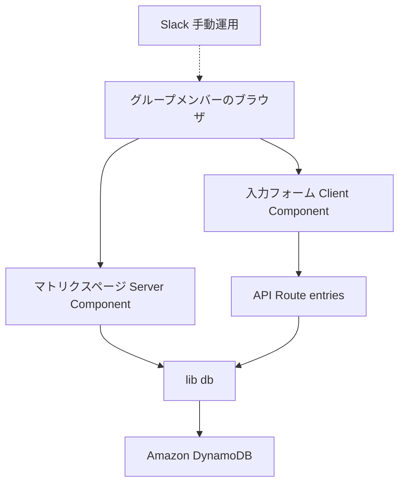
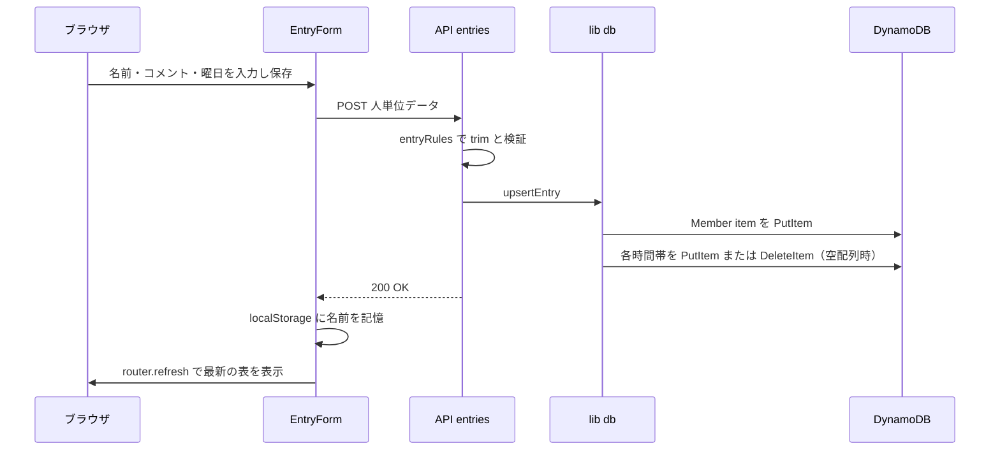

# Design Document — schedule-matrix

## Overview
**Purpose**: 定例会に集まりたい社会人グループへ、全員の希望日時を1枚で可視化する常設マトリクス表を提供する。
**Users**: グループメンバー（数人〜10人）が、自分のタイミングで希望曜日・コメントを入力し、表を見て集まりやすい曜日×時間帯を判断する。
**Impact**: 新規アプリ。既存システムへの影響なし。

### Goals
- 名前×固定4時間帯のマトリクスの閲覧・入力・上書き・削除（要件 1, 2, 5）
- ログインなしの疑似本人確認と人単位コメント（要件 3, 4）
- 無料枠のみ・運用ゼロメンテで常設稼働（要件 6）

### Non-Goals
- 認証・なりすまし防止、自動リセット・cron、Slack 通知自動化、時間帯の追加削除 UI、リアルタイム同期、専用モバイルUI

## Boundary Commitments

### This Spec Owns
- マトリクス表示・入力フォーム・削除の全 UI と、その背後の API（`/api/entries`）
- DynamoDB テーブル `gaia-calendar` の item 設計とデータ整合性ルール（trim、空配列=item削除、上書き保存、人単位の全item削除）
- ブラウザ localStorage に記憶する本人名（キー `gaia-calendar:name`）

### Out of Boundary
- 毎週の入力促し（Slack 手動運用）
- AWS アカウント・IAM ユーザー自体の管理（作成は手順書に従い手動で行う）
- 固定4時間帯の変更（コード内定数の書き換えで対応。UI は作らない）

### Allowed Dependencies
- Amazon DynamoDB（唯一の永続化先。アクセスは `lib/db.ts` 経由のみ）
- Vercel（ホスティング。実行時に `AWS_ACCESS_KEY_ID` / `AWS_SECRET_ACCESS_KEY` / `AWS_REGION` / `DYNAMO_TABLE_NAME` を環境変数で受け取る）
- 依存制約: AWS 認証情報はサーバーサイド専用。`NEXT_PUBLIC_` プレフィックス禁止。クライアントから DynamoDB へ直接続しない。IAM ポリシーは当該テーブル1つへの最小権限に限定する

### Revalidation Triggers
- `/api/entries` のリクエスト/レスポンス形状の変更
- DynamoDB の PK/SK 設計・item 形状の変更
- 固定時間帯定数（`SlotId`）の変更
- localStorage キー名の変更

## Architecture

### Architecture Pattern & Boundary Map


**Architecture Integration**:
- Selected pattern: Next.js App Router の「読み取りは Server Component 直接、変更は API Route 集約」構成（選定理由は research.md の Option 比較参照）
- 依存方向（左からのみ import 可）: `types.ts` → `timeSlots.ts` → `db.ts` → API Route / Page → UI Components
- Steering compliance: tech.md の合意スタック（Next.js + Vercel + DynamoDB、全て無料枠、認証なし。Lambda は挟まない＝Vercel の API Routes 自体がサーバーレス関数）に一致

### Technology Stack

| Layer | Choice / Version | Role in Feature | Notes |
|-------|------------------|-----------------|-------|
| Frontend | Next.js 15（App Router）+ React + TypeScript | マトリクス表示・入力フォーム | `create-next-app` 既定構成 |
| Backend | Next.js Route Handlers | `/api/entries` の upsert / delete | 同一リポジトリ |
| Data | Amazon DynamoDB（Always Free: 25GB・25RCU/WCU） | member / preference item の永続化 | `@aws-sdk/client-dynamodb` + `@aws-sdk/lib-dynamodb` v3 |
| Infrastructure | Vercel（無料枠） | ホスティング | デプロイは動作確認後 |
| Docs | LikeC4 | アーキテクチャ図（`docs/architecture/`） | `npx likec4 start` でプレビュー |

## File Structure Plan

### Directory Structure
```
app/
├── layout.tsx               # ルートレイアウト（タイトル等）
├── page.tsx                 # マトリクスページ（Server Component。db.getMatrix() を呼び表示）
├── globals.css              # 全体スタイル（マトリクスの横スクロール含む）
└── api/entries/route.ts     # POST=人単位の上書き保存 / DELETE=人単位削除
components/
├── MatrixTable.tsx          # マトリクス表（Client Component。localStorage名と一致する行に編集/削除ボタン表示）
├── EntryForm.tsx            # 入力フォーム（Client Component。名前/コメント/4時間帯×曜日チェック、保存でPOST）
└── DeleteConfirm.tsx        # 削除確認（confirm ダイアログのラッパー。MatrixTable から使用）
lib/
├── types.ts                 # SlotId / Weekday / MemberEntry / API リクエスト型
├── timeSlots.ts             # 固定4時間帯・曜日の定数定義
├── entryRules.ts            # 純粋ロジック（名前trim検証、空配列=削除の振り分け、最終編集日時算出）
├── identity.ts              # localStorage の本人名 読み書き（クライアント専用）
└── db.ts                    # DynamoDB DocumentClient + getMatrix / upsertEntry / deleteEntry
infra/
└── dynamodb-setup.md        # テーブル定義・IAM最小権限ポリシー・作成手順（AWS CLI コマンド付き）
docs/architecture/
└── model.c4                 # LikeC4 モデル（context / container ビュー）
.env.local                   # SUPABASE_URL / SUPABASE_SERVICE_ROLE_KEY（git管理外）
```

> `entryRules.ts` を `db.ts` から分離するのは、DB接続なしで単体テストできる純粋関数に整合性ルールを集めるため。

## System Flows

### 保存フロー（人単位 upsert）


- 名前が空（trim後）なら API は 400 を返し、フォームがインラインエラー表示（2.5）
- 各時間帯の upsert/delete は逐次実行。途中失敗時は 500 を返し、フォームが再試行を案内（部分更新は許容し、再保存で収束する）

## Requirements Traceability

| Requirement | Summary | Components | Interfaces | Flows |
|-------------|---------|------------|------------|-------|
| 1.1 | マトリクス表示（名前×固定4枠） | page.tsx, MatrixTable, timeSlots | db.getMatrix | - |
| 1.2 | セルに希望曜日一覧 | MatrixTable | MemberEntry | - |
| 1.3 | 未入力セルは空欄 | MatrixTable, entryRules | MemberEntry.preferences | - |
| 1.4 | コメントと最終編集日時の表示 | MatrixTable, entryRules | MemberEntry.lastEditedAt | - |
| 1.5 | 空状態の案内 | page.tsx, MatrixTable | - | - |
| 2.1 | trim して保存し表を更新 | api/entries, entryRules | POST /api/entries | 保存フロー |
| 2.2 | 同名同時間帯は上書き | db.ts, infra/dynamodb-setup.md | PK+SK の一意性（PutItem=上書き） | 保存フロー |
| 2.3 | 再読み込みでも保持（永続化） | db.ts | DynamoDB | - |
| 2.4 | 空曜日=行削除でセルを空欄に | api/entries, entryRules, db.ts | POST /api/entries | 保存フロー |
| 2.5 | 空名前はエラー | api/entries, entryRules, EntryForm | 400 レスポンス | 保存フロー |
| 3.1 | 保存時に名前をブラウザに記憶 | EntryForm, identity | localStorage | 保存フロー |
| 3.2 | 一致する行にのみ編集/削除表示 | MatrixTable, identity | - | - |
| 3.3 | 他人の行に操作を表示しない | MatrixTable, identity | - | - |
| 4.1 | コメント保存・表示 | EntryForm, api/entries, MatrixTable | POST /api/entries | 保存フロー |
| 4.2 | コメント上書き | db.ts | members upsert | 保存フロー |
| 4.3 | コメントなしでも行表示 | MatrixTable | MemberEntry | - |
| 5.1 | 人単位の全データ削除 | DeleteConfirm, api/entries, db.ts | DELETE /api/entries + Query→全item削除 | - |
| 5.2 | 削除前の確認 | DeleteConfirm | confirm | - |
| 6.1 | ログイン不要 | 全体（認証層を持たない） | - | - |
| 6.2 | URLを開くだけで利用可能 | page.tsx | - | - |
| 6.3 | スマホ/PC対応 | globals.css, MatrixTable | 横スクロール+sticky名前列 | - |
| 6.4 | 自動リセットしない | 設計全体（削除系は 5.1 のみ） | - | - |

## Components and Interfaces

| Component | Domain/Layer | Intent | Req Coverage | Key Dependencies | Contracts |
|-----------|--------------|--------|--------------|------------------|-----------|
| page.tsx | UI/Server | 表データ取得と全体レイアウト | 1.1, 1.5, 6.2 | db.ts (P0) | - |
| MatrixTable | UI/Client | マトリクス描画と本人行の操作表示 | 1.1-1.5, 3.2, 3.3, 4.3, 6.3 | identity (P0) | State |
| EntryForm | UI/Client | 入力・保存・名前記憶 | 2.1, 2.5, 3.1, 4.1 | api/entries (P0), identity (P0) | API |
| DeleteConfirm | UI/Client | 削除の確認と実行 | 5.1, 5.2 | api/entries (P0) | API |
| api/entries | Backend | 人単位 upsert / delete の唯一の変更窓口 | 2.1-2.5, 4.1, 4.2, 5.1 | entryRules (P0), db.ts (P0) | API |
| entryRules | Logic | 整合性ルールの純粋関数群 | 2.1, 2.4, 2.5, 1.4 | types (P0) | Service |
| identity | Logic/Client | localStorage の本人名管理 | 3.1-3.3 | - | Service |
| db.ts | Data | DynamoDB アクセスの唯一の窓口 | 2.2, 2.3, 5.1 | aws-sdk v3 (P0) | Service |

### Logic / Data 層の詳細

#### entryRules

| Field | Detail |
|-------|--------|
| Intent | DB 非依存の整合性ルール（テスト容易性のための分離） |
| Requirements | 2.1, 2.4, 2.5, 1.4 |

##### Service Interface
```typescript
/** 名前を trim し、空なら invalid を返す */
function validateName(raw: string): { ok: true; name: string } | { ok: false; error: "EMPTY_NAME" };

/** 時間帯ごとの希望を upsert 対象と delete 対象に振り分ける */
function planSlotWrites(preferences: Record<SlotId, Weekday[]>): {
  upserts: { slotId: SlotId; weekdays: Weekday[] }[];
  deletes: SlotId[];
};

/** メンバーの updated_at 群から最終編集日時（最大値）を返す */
function latestEditedAt(timestamps: string[]): string | null;
```
- Preconditions: 入力は API で JSON パース済み
- Postconditions: `planSlotWrites` は全 SlotId をちょうど1回、upserts か deletes のどちらかに割り当てる
- Invariants: weekdays が空配列 ⇔ deletes に入る

#### db.ts

| Field | Detail |
|-------|--------|
| Intent | DynamoDB への読み書きを集約（他ファイルからの直接続禁止） |
| Requirements | 2.2, 2.3, 5.1 |

##### Service Interface
```typescript
function getMatrix(): Promise<MemberEntry[]>;                // Scan（〜50 item 想定のため許容）して人単位に組み立て
function upsertEntry(entry: ValidatedEntry): Promise<void>;  // Member item を PutItem + 各時間帯を PutItem/DeleteItem
function deleteEntry(name: string): Promise<void>;           // Query(PK=name) → 全 item を削除（cascade は手動実装）
```
- Invariants: updatedAt はこの層が書き込み時に必ず設定する（DynamoDB に default はない）

#### api/entries

##### API Contract
| Method | Endpoint | Request | Response | Errors |
|--------|----------|---------|----------|--------|
| POST | /api/entries | `{ name: string; comment: string; preferences: Record<SlotId, Weekday[]> }` | `{ ok: true }` | 400 (EMPTY_NAME / 不正なslot・曜日), 500 (DB障害) |
| DELETE | /api/entries | `{ name: string }` | `{ ok: true }` | 400 (EMPTY_NAME), 500 (DB障害) |

#### identity

##### State Management
- State model: localStorage キー `gaia-calendar:name` に自分の名前（trim後）を保持
- Persistence & consistency: ブラウザ単位。消えた場合は同じ名前の再入力で復帰（research.md リスク参照）
- Concurrency strategy: なし（単一ブラウザ内のみ）

### 型定義（共有）
```typescript
type SlotId = "19-21" | "21-23" | "8-10" | "10-12";
type Weekday = "月" | "火" | "水" | "木" | "金" | "土" | "日";

interface MemberEntry {
  name: string;
  comment: string;
  /** 全 SlotId をキーに持つ。空配列 = その時間帯の希望なし（行なし） */
  preferences: Record<SlotId, Weekday[]>;
  /** updated_at の最大値（ISO 8601）。表示用の導出値 */
  lastEditedAt: string;
}
```

## Data Models

### Physical Data Model（DynamoDB シングルテーブル）

テーブル `gaia-calendar`（プロビジョンド 25RCU/25WCU = Always Free 内、オンデマンドは使わない）

| Item 種別 | PK (name) | SK | 属性 |
|-----------|-----------|-----|------|
| Member | 参加者名（trim済み） | `MEMBER` | `comment: string`, `updatedAt: string(ISO 8601)` |
| Preference | 参加者名（trim済み） | `SLOT#{slot_id}`（例 `SLOT#19-21`） | `weekdays: string[]`, `updatedAt: string(ISO 8601)` |

- **一意性**: PK+SK がキーなので unique 制約は不要。PutItem がそのまま「上書き保存」になる（2.2）
- **「空セル」**= Preference item の不存在（要件 2.4 / 1.3 の一義化）
- **人単位削除**: cascade はないため `Query(PK=name)` → 全 item 削除を db.ts が実装（5.1）
- **最終編集日時**: 保存せず `updatedAt` の最大値から導出（steering の決定事項）。値はアプリコードが書き込む
- テーブル定義・IAM 最小権限ポリシー・作成コマンドは `infra/dynamodb-setup.md` に記載

## Error Handling

### Error Categories and Responses
- **User Errors (400)**: trim後の空名前、未知の slot_id / 曜日 → フォームにインラインエラー表示。保存は行わない
- **System Errors (500)**: DynamoDB 接続失敗・認証エラー・スロットリング → 「保存に失敗しました。時間をおいて再試行してください」を表示。表示側（page.tsx）の取得失敗時はエラーメッセージと再読み込み案内を表示
- 部分更新（時間帯ごとの書き込み途中失敗）は再保存で収束する設計（PutItem の冪等性）

### Monitoring
- Vercel の標準ログ（Route Handler の console.error）のみ。追加の監視基盤は無料枠制約により導入しない

## Testing Strategy

### Unit Tests（entryRules を中心に）
1. `validateName`: 前後空白の除去、空白のみ→ EMPTY_NAME（2.1, 2.5）
2. `planSlotWrites`: 空配列の時間帯が deletes に、非空が upserts に入り、全 SlotId が網羅される（2.4）
3. `latestEditedAt`: 複数タイムスタンプから最大値、空なら null（1.4）

### Integration / E2E（手動チェックリスト。実装完了の受け入れ条件）
1. 入力→保存→リロードで内容が残る（2.1, 2.3）
2. 同名で再保存して行が増えず上書きされる（2.2）
3. 曜日を全部外して保存→セルが空欄に戻る（2.4）
4. localStorage のないブラウザ（シークレットウィンドウ）では他人の行に編集/削除が出ない（3.2, 3.3）
5. コメントの表示・上書き・空のまま（4.1-4.3）
6. 削除確認→実行で行が消える（5.1, 5.2）
7. スマホ幅で横スクロールできて名前列が固定される（6.3）

## Security Considerations
- AWS 認証情報（アクセスキー）はサーバーサイド環境変数のみ。`NEXT_PUBLIC_` 禁止。`.env.local` は .gitignore 対象
- IAM ユーザーは本アプリ専用に新規作成し、`gaia-calendar` テーブル1つに対する GetItem/PutItem/DeleteItem/Query/Scan のみ許可（最小権限）。コンソールアクセスは付与しない
- クライアントから DynamoDB へは接続しない（唯一の読み書き経路はサーバーサイドの lib/db.ts）
- なりすまし防止は非目標（要件 Adjacent expectations）。URL を知る人は誰でも読み書き可能である旨を README に明記
