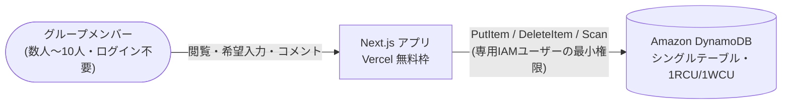

# gaia-calendar

複数人（社会人）が2時間だけ集まれる日を、毎回すり合わせずに見つけるための常設スケジュール表です。
縦軸=名前、横軸=時間帯のマトリクス表に、各自の希望曜日を書き込んでいくだけで、集まりやすい時間帯が見えてきます。

> [!NOTE]
> このリポジトリは設計と実装を公開するためのもので、そのままクローンしても動きません。
> 起動には自分のAWSアカウント上の DynamoDB テーブルと IAM ユーザーが必要です（手順は [infra/dynamodb-setup.md](infra/dynamodb-setup.md)）。
>
> 本番URLも非公開です。実際の友人グループが運用中のツールで、ログイン不要（誰でも書き込める）設計のため、
> URLを公開すると実データが荒らされてしまいます。

## 主な機能

- ログイン不要・名前入力のみで希望曜日を書き込める
- 常設1枚の表を全員で更新し続ける（週ごとにポールを立て直す方式ではない）
- 表示は今週分のみ。毎週月曜0時（JST）に希望曜日とコメントがリセットされ、名前だけが残る
- 一言コメント欄で「今週は無理そう」などの状況も添えられる

## 使い方

URLを開いて名前を入力し、参加できそうな曜日にチェックを入れて保存するだけです。
自分の名前で保存した行だけが、次回以降ブラウザに記憶され編集・削除できるようになります。

## アーキテクチャ

データモデル・週次リセットの仕組み・DynamoDB容量設計の詳細は [docs/architecture.md](docs/architecture.md) にまとめています。

## 技術スタック

| 領域 | 技術 |
|---|---|
| フロントエンド | Next.js 15 (App Router) / React 19 |
| バックエンド | Next.js Route Handlers（Vercel 上でサーバーレス実行） |
| データ層 | Amazon DynamoDB（シングルテーブル設計） |
| ホスティング | Vercel（無料枠） |
| テスト | Vitest / Testing Library |

## リポジトリの歩き方

| 見たいもの | 場所 |
|---|---|
| アーキテクチャ図・データモデル・週次リセットの仕組み | [docs/architecture.md](docs/architecture.md) |
| 要件・設計・タスクの記録（仕様駆動開発の過程） | [.kiro/specs/schedule-matrix/](.kiro/specs/schedule-matrix/) |
| DynamoDB テーブルと IAM の構築手順 | [infra/dynamodb-setup.md](infra/dynamodb-setup.md) |
| 週境界（JST月曜0時）の判定ロジック | [lib/weekRange.ts](lib/weekRange.ts) |
| 時間帯の定義（唯一の正） | [lib/timeSlots.ts](lib/timeSlots.ts) |

なお画面の表示名は環境変数 `SITE_TITLE` で差し替えられます（未設定なら「カレンダー」）。
