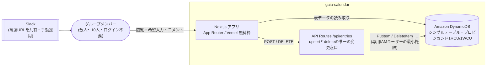

# gaia-calendar

複数人（社会人）が2時間だけ集まれる日を、毎回すり合わせずに見つけるための常設スケジュール表。

> 本番URLは非公開です。実際の友人グループが運用中のツールで、認証機能を持たない設計のため、
> 誰でもアクセスできるURLを公開すると実データが荒らされてしまいます。詳細は下記アーキテクチャ図を参照してください。

## 課題（WHY）

「平日夜21時」「土曜朝8時」のように固定枠を決め打ちしていたが、寝落ち・起きられないで欠席が続いていた。
みんなの希望日時をバラバラのタイミングで入力してもらい、一覧で可視化することで、実際に集まりやすい時間帯を見つけたい。

## できること（WHAT）

縦軸=名前、横軸=時間帯（固定2枠）のマトリクス表。各セルに、その人がその時間帯で希望する曜日が入る。

- ログイン不要・名前入力のみ
- 常設1枚の表を全員で更新し続ける（週ごとにポールを立て直す方式ではない）
- 表示は今週分のみ。毎週月曜0時（JST）に希望曜日とコメントがリセットされ、名前だけが残る

## アーキテクチャ



## 技術スタック

| 領域 | 技術 |
|---|---|
| フロントエンド | Next.js 15 (App Router) / React 19 |
| バックエンド | Next.js Route Handlers（Vercel 上でサーバーレス実行） |
| データ層 | Amazon DynamoDB（シングルテーブル設計） |
| ホスティング | Vercel（無料枠） |
| テスト | Vitest / Testing Library |

## 設計判断のハイライト

- **週次リセットに cron を使わない**: 「今週分だけ表示」を、バッチ実行ではなく `weekKey`（保存時に刻む「どの週の入力か」）の論理判定で実現している。cron を持たないため「実行が落ちた週だけ古いデータが残る」という障害が原理的に起きない。判定は必ずサーバー側で行い、クライアント側の時計は信用しない（[lib/weekRange.ts](lib/weekRange.ts)）
- **DynamoDB を無料枠のまま運用する容量設計**: AWSの DynamoDB Always Free（25RCU/25WCU）はテーブル単位ではなくアカウント単位の共有資源。実測トラフィックに対して1RCU/1WCUで十分と判断し、余った枠を他プロジェクトに残す設計にした（[infra/dynamodb-setup.md](infra/dynamodb-setup.md)）
- **IAMは最小権限**: アプリ専用のIAMユーザーに、対象テーブル1つへの読み書き5アクションのみを許可。キーが漏れても被害は「このテーブル1つ」に限定される
- **TTLは名簿の掃除役、リセットの主役ではない**: `expiresAt`（書き込みから30日）は「もう来なくなった人」を自動で消すための保険であり、週次リセットの実装はあくまで `weekKey` が担う

## セットアップ

```bash
npm install
npm run dev
```

DynamoDB テーブルとIAMユーザーの作成手順は [infra/dynamodb-setup.md](infra/dynamodb-setup.md) を参照。

## テスト

```bash
npm test
```

## ドキュメント

- [設計判断記録（ADR）](docs/decisions/)
- [運用手順](docs/runbooks/)
