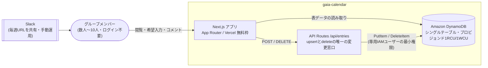
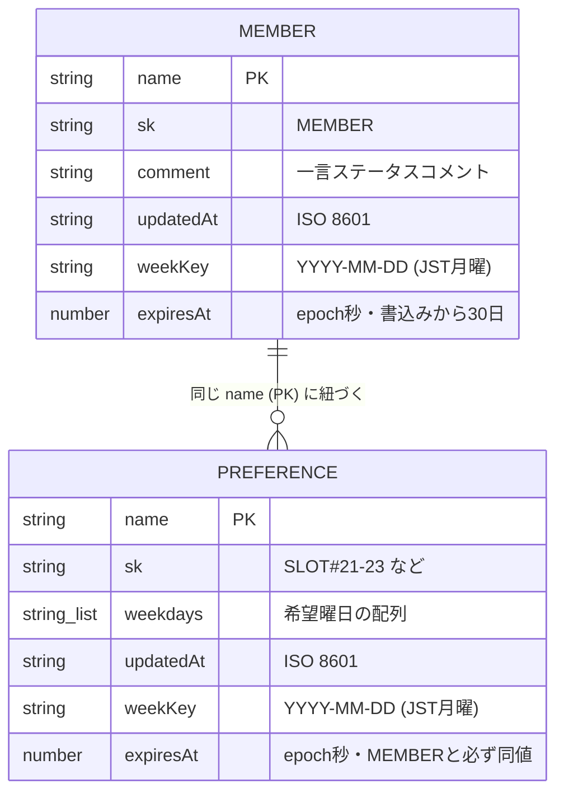
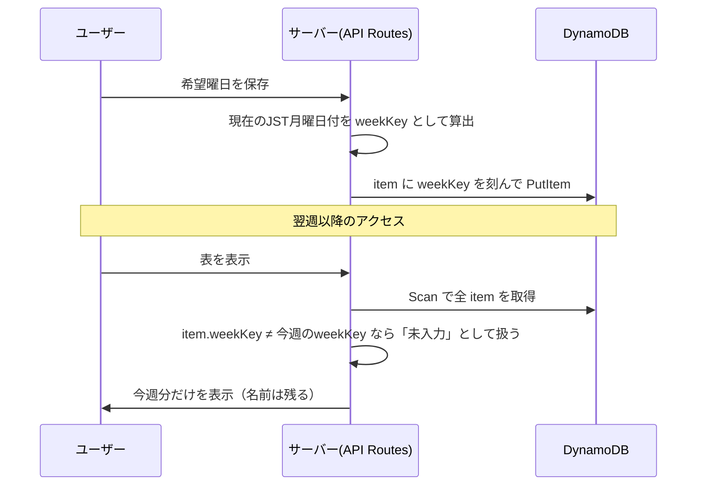

# アーキテクチャ詳細

## 全体構成

## データモデル

DynamoDB はシングルテーブル設計。「人（member）」と「人×時間帯の希望（preference）」の2種類の item を、
`name` をパーティションキーに共存させている。

- `weekdays` や `comment` は attribute-definitions に定義しない。DynamoDB はキー以外スキーマレスに保存できる
- MEMBER と PREFERENCE の `expiresAt` は必ず同じ値にする。MEMBER だけ先に消えると「名前だけの行」が復活するため

## 週次リセットの仕組み（cronを使わない）

バッチ実行を持たないため「実行が落ちた週だけ古いデータが残る」という障害が原理的に起きない。
判定は必ずサーバー側で行い、クライアント端末の時計は信用しない。

## 容量設計（無料枠の範囲で運用する）

AWSの DynamoDB Always Free（25RCU/25WCU）は**テーブル単位ではなくAWSアカウント単位**の共有資源。
1つのテーブルが25/25を確保すると、同じアカウントの他プロジェクトが無料枠を使えなくなる。

- 実測トラフィック（直近14日で最も混んだ1時間: 書き込み78ユニット・読み取り31.5ユニット）に対し、
  1RCU/1WCU（1時間あたり3,600ユニットの供給）で十分と判断
- アプリ専用のIAMユーザーには、対象テーブル1つへの `GetItem` / `PutItem` / `DeleteItem` / `Query` / `Scan` の
  5アクションのみを許可。キーが漏れても被害は「このテーブル1つの読み書き」に限定される
- TTL（`expiresAt`）は「もう来なくなった人」を自動で消す名簿の掃除役。週次リセットの実装ではない

再現手順（テーブル作成・IAMポリシー・TTL設定のコマンド一式）は [infra/dynamodb-setup.md](../infra/dynamodb-setup.md) を参照。
